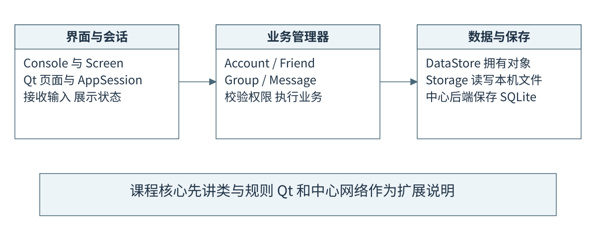
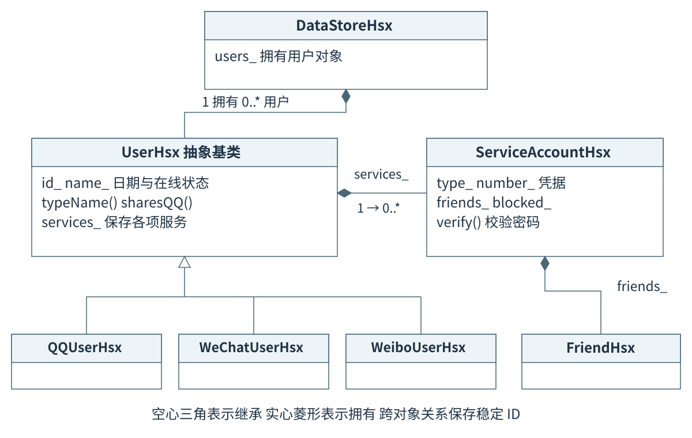
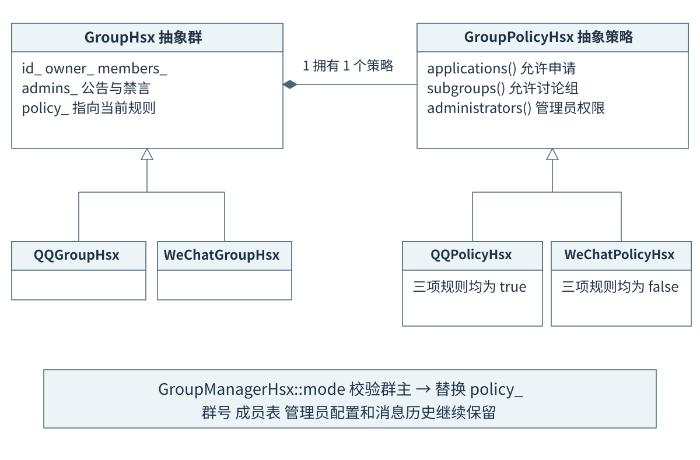
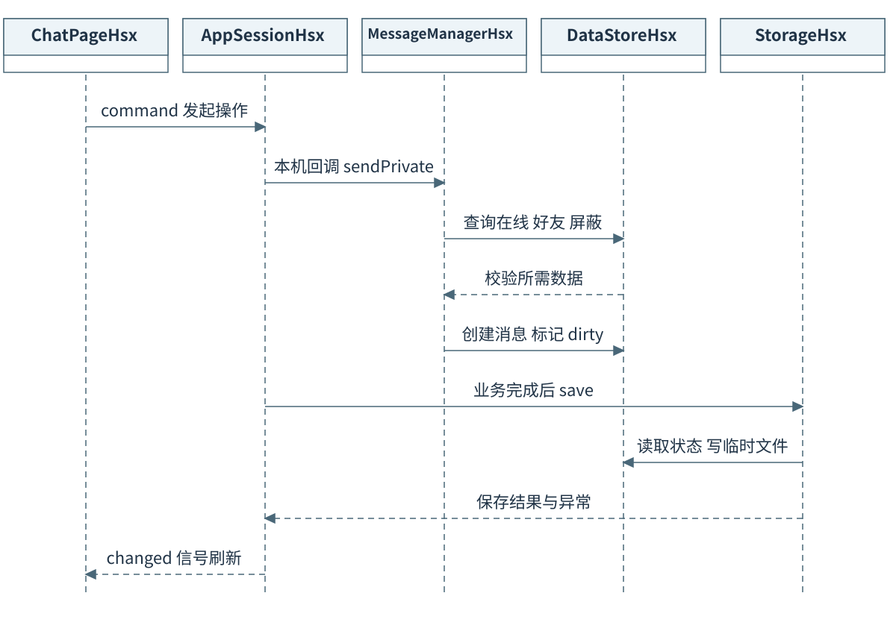

# 听澜课程设计答辩口述稿

依据课程任务书的五个技术层次组织。主讲约 6 至 8 分钟，现场演示另留 2 至 3 分钟；按自己的语速彩排。括号内的操作提示不用朗读。

任务书的考核标准是“参照5个技术层次划分”，没有给具体分值。可视化被列入课后扩展，主讲优先覆盖 C++ 类设计、业务规则、菜单和文件保存。

## 1 开场与总体结构

*操作提示 先指向界面 业务 数据三列 不展开扩展界面功能*



老师好，我的课程设计是听澜模拟即时通信系统。按照题目要求，我把统一平台中的用户、服务账号、好友、群和消息分开建模，实现资料维护、服务开通和联动登录、好友增删改查、共同好友与跨服务推荐，以及群成员管理和管理规则动态切换。当前开放 QQ、微信和微博三项服务。

这张图说明各部分的职责。控制台和界面接收操作，业务管理器检查规则，DataStore 统一保存内存对象，Storage 负责文件读写。这样的划分让界面变化时，好友、群和消息的核心规则仍能复用。下面我重点说明对象关系，以及群策略怎样体现继承和多态。

## 2 用户类与组合关系

*操作提示 指空心三角说明继承 再指菱形说明组合*



请看用户类图。UserHsx 表示平台中的一个人，保存内部 ID、昵称、日期等公共资料。QQUserHsx、WeChatUserHsx 和 WeiboUserHsx 继承它，实现类型等虚函数。通过基类接口可以使用不同来源的用户对象。

一个人开通多项服务，通过内部的 services 容器组合多个 ServiceAccountHsx 实现。每个服务账号保存自己的号码、密码摘要、好友表和黑名单。这样只需维护一份人的资料，同时保留不同服务的账号信息。微博使用本人 QQ 号码，微信使用独立号码，并允许绑定本人 QQ。

DataStore 用 map 和 unique_ptr 拥有用户与群；好友、群成员和消息端点通过内部 ID 关联。因此修改昵称时，关系仍能找到原来的用户。私有数据配合只读查询和管理器接口，实现受控修改。

## 3 群策略切换与运行时多态

*操作提示 指向 policy_ 这条组合关系 再展示三行核心代码*



群管理是我重点展示的设计。GroupHsx 保存群号、群主、成员和管理员配置，内部组合一个 GroupPolicyHsx 策略对象。QQPolicyHsx 允许申请入群、管理员和讨论组；WeChatPolicyHsx 关闭这些规则，成员通过邀请加入，管理权限由群主行使。

管理器通过策略基类的虚函数查询规则，实际执行的是当前派生策略的实现，这就是运行时多态。群主切换模式时，先检查权限，再创建并替换策略对象，最后标记数据需要保存。

这里保留同一个群对象，成员表、群号和历史继续保留。管理员名单也保留，只是在微信策略下不产生管理员权限；切回 QQ 策略后可以恢复。原生群类型和当前管理规则分别表达，所以能在不损害成员数据的情况下动态变换管理特色。

```cpp
requireManager(actor, type, group, true);
data_.editGroup(group).policy_ = GroupPolicyHsx::create(mode);
data_.dirty_ = true;
```

## 4 业务接口与文件保存

*操作提示 这一张是本机路径 远程路径只在最后补充一句*



以本机发送一条私聊消息为例。页面把目标和正文交给 AppSession，由 MessageManager 检查发送者在线、对方是当前服务好友、双方未屏蔽，然后分配消息编号并写入 DataStore。界面只发起用例，具体约束由业务层集中处理。

保存时，Storage 先写临时文件，检查写入成功并保留备份后替换主文件。加载时先解析到临时仓库，校验用户、好友和群之间的关联，全部通过才替换当前内存。启动可以恢复服务、关系和消息，登录状态重新认证。

控制台保留数字菜单和返回操作。程序中的管理器和领域类分别放在独立的头文件与实现文件中，名称使用 Hsx 后缀；在这些课程核心之外，我补充了 Qt 和中心服务器，远程业务由服务器校验、事务保存后同步。

## 5 现场演示口述

以下操作使用隔离演示副本和测试账号。预置 1001 至 1006 等群号由 DemoDataHsx 夹具提供；正式中心新库不会自动建立演示账号。先排练，再按现场已经出现的结果讲述。

### 第一步 账号与服务

我先登录隔离演示副本，查看资料、已开通服务和服务号码。这里是同一个内部用户，可以切换自己开通的 QQ 和微信，复用已经认证的会话。联动登录不要求各服务密码相同，也不替别人登录。

### 第二步 好友与跨服务推荐

现在查看共同好友，再把 QQ 好友作为微信的推荐来源。例如 QQ 有 B、C，微信已有 B，共同好友就是 B，推荐候选是 C。推荐后仍发申请，接收者同意时同时更新双方好友记录；备注、分组、查询和删除也通过管理器处理。

### 第三步 群特色与动态切换

这是已有 QQ 群。我先展示申请、管理员和讨论组功能，再由群主切换到微信策略。请注意群号和成员保持不变；这时主动申请和新建讨论组会被拒绝，管理员权限暂时失效，群主仍可管理。最后切回 QQ，验证原管理员配置恢复。

### 第四步 成员操作与数据保存

接着展示邀请成员、查询成员，以及具有权限的移除和退群操作。一个人通过多个服务入群时，只退出一项服务会保留其他服务的成员关联。保存并重启演示副本后，服务、好友和群数据仍能恢复，在线身份重新认证。

### 第五步 扩展与结束

如果时间允许，我再用两个测试客户端演示中文消息。这里的 TCP 和 Qt 是扩展：中心服务器处理账号、权限和保存。当前设计适合课程规模，整体快照和遍历查询仍有容量限制，后续可以做分页、索引和增量同步。我的主要设计说明到这里，谢谢老师。

## 6 评分要求与实现证据

| 技术层次 | 原要求重点 | 源码中的证据 | 讲解方式 |
| --- | --- | --- | --- |
| 基本层次 | 完成功能要求 | 账号和服务、好友维护、共同好友与推荐、群操作和动态模式、启动加载 | 先演示功能，再说明具体对象和接口 |
| 支持对象层次 | 正确划分类并利用对象技术 | User、ServiceAccount、Friend、Group、Message、DataStore 与各 Manager | 指图说明每个对象保存什么，谁拥有它 |
| 抽象封装层次 | 继承或组合复用，保护数据接口 | 抽象基类、服务账号组合、私有成员、const 查询、受信任管理器修改 | 解释继承来源与组合服务的区别 |
| 面向对象层次 | 支持多态与设计原则优化 | GroupPolicy 虚函数、QQ/微信派生策略、mode 动态替换 | 重点讲策略如何变化且成员保持不变 |
| 优化提高层次 | 菜单、I/O、扩展性、灵活性、注释、UML 和独立类文件命名 | 数字菜单、Storage、ID 关联、策略模式、配图、Hsx 命名与独立文件 | 展示证据，不给自己推算分数 |

优化提高层次中的七项分别是数字菜单、I/O、扩展性、群规则灵活变化、必要注释、简单 UML、独立类文件与姓名缩写命名。自写领域类与业务类采用 Hsx 后缀；Qt 和第三方库的外部类型遵循各自命名。

任务书还要求检查前提交报告并接受质疑。可视化编程列为课后不考核扩展，点对点 TCP 为选做；当前项目保留控制台和 NetChatHsx，也包含另行实现的 Qt 中心通信。主讲时明确这几部分的定位。

## 7 追问备用回答

### 为什么要把用户与服务账号分开

一个人只有一份基本资料，但有多个服务号码、凭据和好友表。用户组合服务账号，既避免复制资料，也便于跨服务按同一个人查找。

### 多态到底体现在哪里

GroupPolicy 定义虚函数，群通过基类指针使用策略。当前对象是 QQPolicy 还是 WeChatPolicy，会决定相同接口返回的规则；替换策略后行为随之变化。

### 切换群模式时是否重新创建群

保留原群对象，只替换 policy_。群号、成员、管理员配置和历史继续保留，群的原生 C++ 类型也保持原样。

### 为什么使用 unique_ptr 和虚析构

unique_ptr 表示对象由一个所有者管理并自动释放。用户和群通过基类指针保存派生对象，基类虚析构保证销毁时正确执行派生对象的析构。

### 为什么好友关系存 ID

内部 ID 稳定，昵称可以修改。关系通过仓库查找目标对象，无需复制整个人，也避免把可变昵称当作关系键。

### 联动登录是否等于共用密码

认证后复用统一用户会话，切换时检查服务已开通。每项服务仍保存自己的账号和凭据，联动不要求密码相同。

### 共同好友与推荐怎样计算

共同好友按内部用户 ID 求交集；推荐从来源服务好友中排除目标服务已有或被自己屏蔽的人。真正添加仍需完整申请校验。

### 如何保证文件损坏时不破坏当前数据

加载先用临时仓库解析和校验，成功后才替换内存；保存先写临时文件、检查结果并保留备份。保存失败要提示，保留内存修改等待处理。

### TCP 为什么还需要长度头

TCP 提供有序字节流，应用消息边界需要协议定义。4 字节长度头配合增量缓冲确定每条 JSON 的范围，处理拆包和粘包。

### 有哪些尚未完成或可继续改进的地方

当前开放三项服务，更多微 X 需要补充业务、界面及兼容逻辑。中心核心状态采用整体快照，面向更大规模还需分页、索引、增量同步及更多并发验证。

## 8 三分钟压缩版与源码定位

老师好，我的课程设计是听澜模拟即时通信系统。按照题目要求，系统实现用户资料、服务开通和联动登录、好友维护与跨服务推荐、群管理及文件保存，当前开放 QQ、微信和微博。

对象设计中，User 表示一个人，通过继承区分来源，通过组合持有多项 ServiceAccount。各服务账号保存号码、凭据和好友表，跨对象关系使用稳定 ID。DataStore 统一拥有用户和群，业务 Manager 负责权限和一致性检查。

最能体现多态的是群策略。Group 保存成员等数据，GroupPolicy 定义规则接口，QQPolicy 和 WeChatPolicy 提供不同实现。群主切换模式时只替换策略对象，所以成员和历史保留，申请、管理员和讨论组规则随当前策略变化。

菜单和界面通过业务接口操作对象。好友申请同意时同时写入双方好友关系；共同好友按 ID 求交集，推荐按已有关系筛选后仍正常申请。文件加载先解析到临时仓库并校验，保存先写临时文件并保留备份。

这些设计对应了类划分、抽象封装、继承组合和运行时多态。数字菜单、文件读写、UML、独立类文件和 Hsx 命名用于完善课程要求。Qt、TCP 和中心数据库是进一步扩展。下面我重点演示群切换前后成员保持不变、管理规则发生变化。

| 被问到什么 | 打开源码 |
| --- | --- |
| 用户与服务组合 | [src/UserHsx.h:8](../src/UserHsx.h#L8) |
| 仓库与所有权 | [src/DataStoreHsx.h:10](../src/DataStoreHsx.h#L10) |
| 群策略接口 | [src/GroupPolicyHsx.h:5](../src/GroupPolicyHsx.h#L5) |
| 替换群策略 | [src/GroupManagerHsx.cpp:108](../src/GroupManagerHsx.cpp#L108) |
| 管理员权限判断 | [src/GroupHsx.cpp:14](../src/GroupHsx.cpp#L14) |
| 共同好友与推荐 | [src/FriendManagerHsx.cpp:73](../src/FriendManagerHsx.cpp#L73) |
| 文件加载与保存 | [src/StorageHsx.cpp:28](../src/StorageHsx.cpp#L28) |
| 预置演示群 | [src/DemoDataHsx.cpp:12](../src/DemoDataHsx.cpp#L12) |

依据 2026 面向对象程序课程设计任务书中题目要求、技术层次要求及说明、考核方式、考核标准整理；上述章节与当前源码交叉核对。

完整类关系说明见 [类设计与 UML](类设计与UML.md)，逐文件顺序见 [源码阅读顺序](源码阅读顺序.md)。
