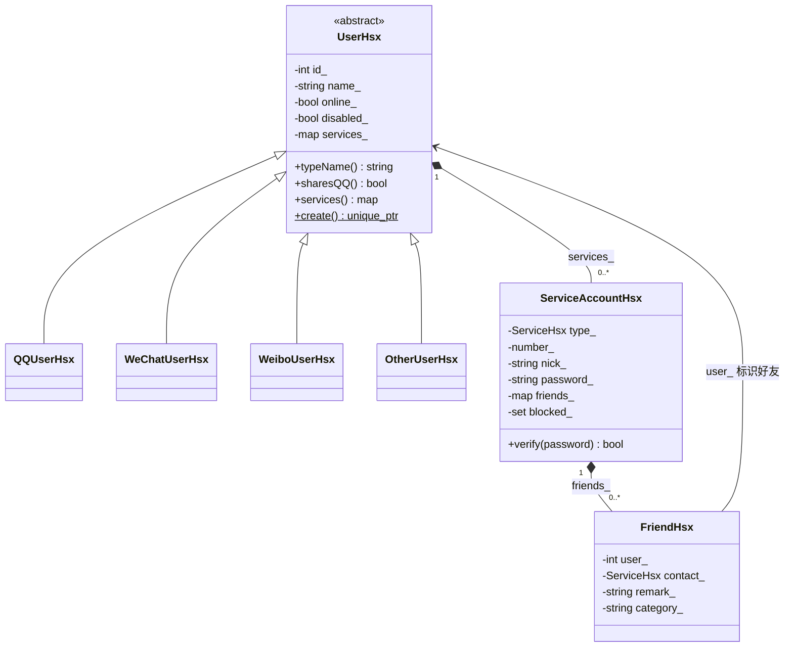
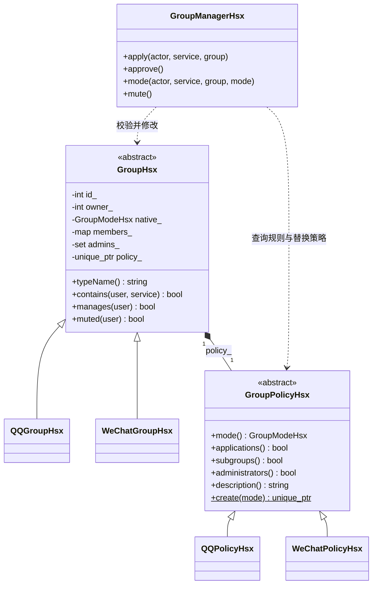
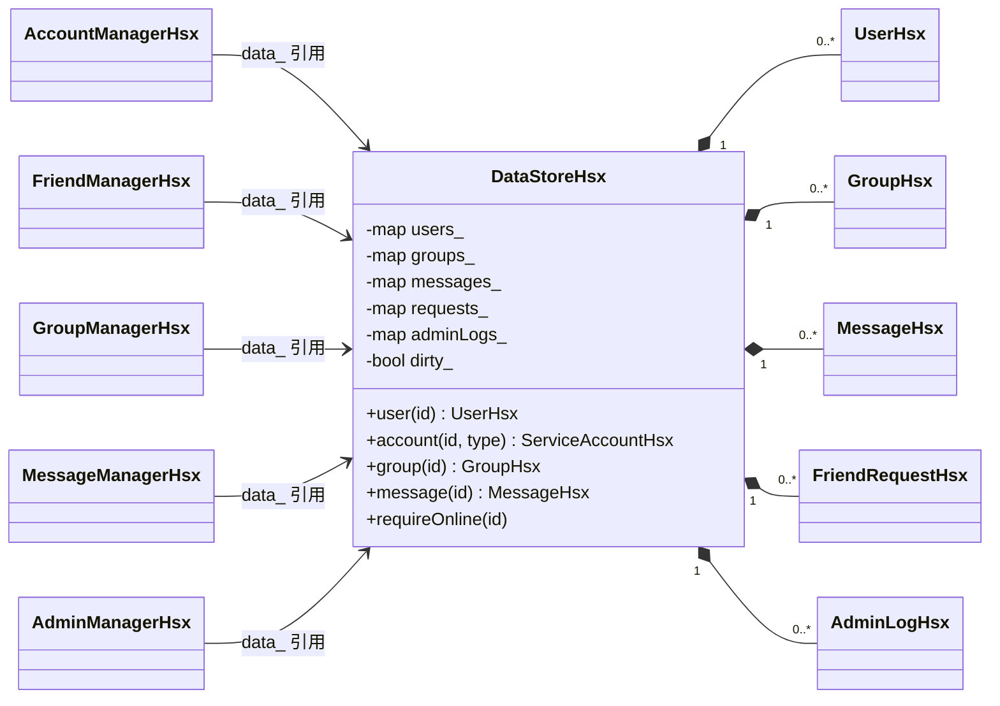
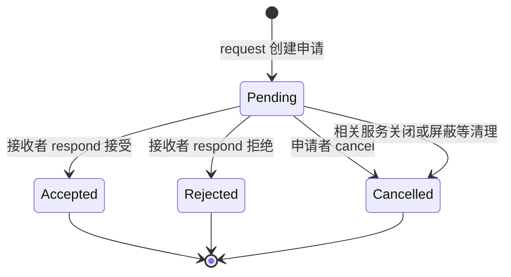
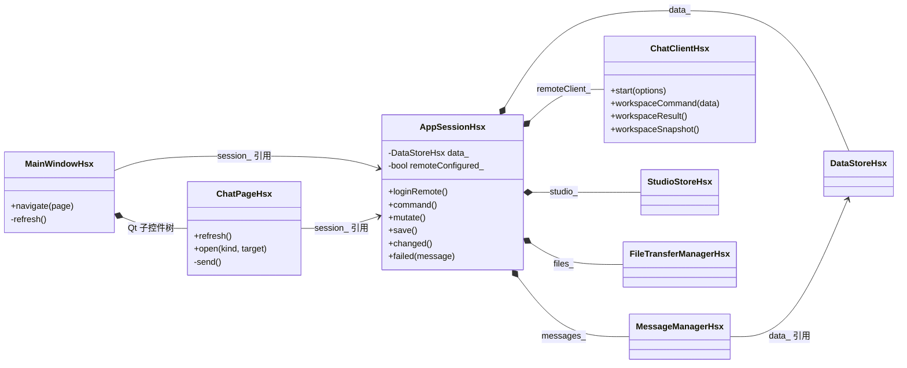
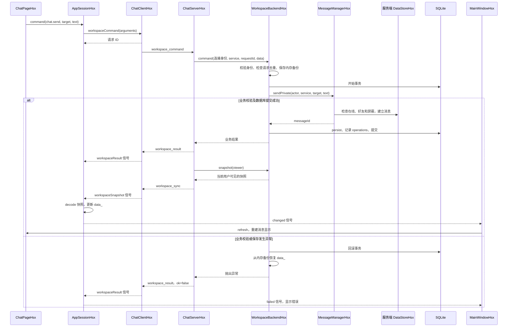
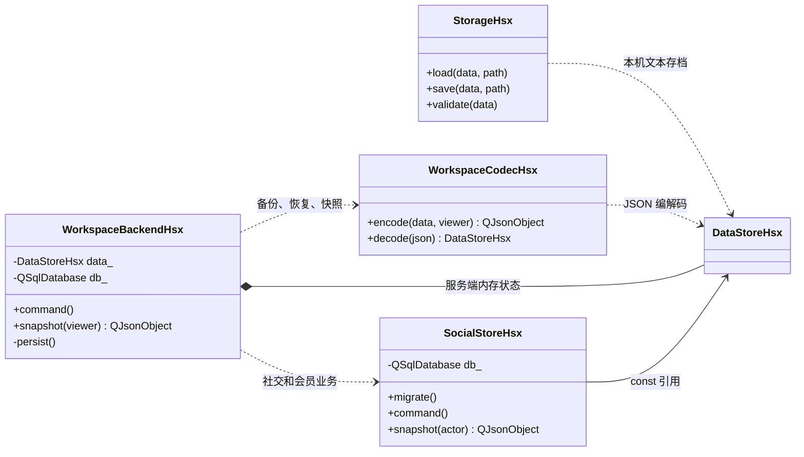
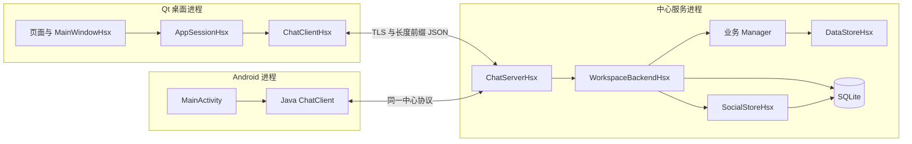

# 听澜的类设计思路与 UML

这份说明按当前源码还原设计逻辑，回答三个问题：**为什么拆成这些类，类之间是什么关系，一项功能怎样通过这些类完成**。逐文件阅读可以配合 [源码阅读顺序](源码阅读顺序.md)。

现场讲解见 [按课程要求组织的配图口述稿](答辩口述稿.md)，其中附有可直接展示的 SVG 类图和流程图。

## 1. 从需求推导类，而不是先背类名

先把需求中的“对象”“动作”“规则”分开，再决定由哪个类负责。

| 需求 | 需要表达的对象或职责 | 当前实现 |
| --- | --- | --- |
| 一个人可以开通多种服务 | 人的公共资料、各服务独立的账号信息 | `UserHsx` + `ServiceAccountHsx` |
| 好友有备注、分组和对方服务 | 一条好友关系 | `FriendHsx` |
| 加好友要经过处理 | 一次申请及其状态 | `FriendRequestHsx` |
| 有私聊、群聊、已读、撤回和收藏 | 一条消息及附加状态 | `MessageHsx` |
| 群有成员、群主、管理员和禁言 | 群的状态 | `GroupHsx` |
| QQ 群、微信群规则不同，还能切换规则 | 可以替换的群规则 | `GroupPolicyHsx` 及两个派生策略 |
| 注册、加好友、发消息要检查权限并修改多处数据 | 用例的业务执行者 | 各种 `ManagerHsx` |
| 对象需要统一查找、编号和保存 | 内存所有权、存档、序列化、数据库 | `DataStoreHsx`、`StorageHsx`、`WorkspaceCodecHsx`、`WorkspaceBackendHsx` |
| 控制台、桌面、手机都要用同一套中心业务 | 展示、会话协调和远程通信 | `ConsoleHsx`、Qt 页面、`AppSessionHsx`、客户端/服务端网络类 |

可以按这个顺序复述设计过程：**找业务对象 → 明确数据归属 → 区分稳定资料与可变规则 → 集中业务校验 → 接上界面 → 增加存储和通信**。

## 2. 先会读 UML 符号

本文的类图省略部分字段、参数和 Qt 基类，保留当前源码中与设计有关的关系。方法名与类名对应真实实现，完整声明见链接中的头文件。

| 表示 | 含义 | 在本项目中的例子 |
| --- | --- | --- |
| `Base <|-- Derived` | 继承，空心三角指向基类 | `QQUserHsx` 继承 `UserHsx` |
| `Owner *-- Part` | 组合，菱形一侧拥有另一侧对象的生命周期 | `UserHsx` 拥有服务账号 |
| `A --> B` | 关联，A 保存或能够导航到 B；具体是引用还是 ID 见说明 | 管理器保存 `DataStoreHsx&` |
| `A ..> B` | 依赖，A 在执行功能时使用 B | `StorageHsx::save()` 使用数据仓库 |
| `1` / `0..*` | 一个 / 零到多个 | 一个仓库保存多个用户 |
| `+` / `-` | 公有 / 私有 | 公有查询接口、私有字段 |
| `<<abstract>>` | 抽象类，含有必须由派生类实现的接口 | `UserHsx`、`GroupPolicyHsx` |
| 方法末尾的 `$` | 静态方法，通过类名调用 | `UserHsx::create()` |

成员引用与 ID 关联都不代表所有权。画图时先问“谁负责销毁对象”，再决定是否使用组合菱形。

## 3. 用户怎么设计：继承表达来源，组合表达服务



**为什么这样拆？** 人的 ID、姓名、生日等公共资料只保留一份；服务号码、凭据、好友和黑名单属于具体服务账号。派生用户类型记录账号来源，开通或关闭服务通过修改 `services_` 完成。

例如，一个 `WeChatUserHsx` 对象后来可以开通 QQ 服务，`UserHsx` 的动态类型仍是微信用户，`services_` 中增加一个 QQ 服务账号。整个用户对象、其他服务和关系可以继续保留。

实现关键是 [UserHsx.h](../src/UserHsx.h) 中的成员：

```cpp
std::map<ServiceHsx, ServiceAccountHsx> services_;
```

键是服务类型，值是该服务账号。图中的 `0..*` 表达容器能够保存多个元素；正常业务注册时至少建立一个服务，关闭服务时要求至少保留一个，当前界面提供三种有效服务。

`UserHsx` 的 `typeName()`、`sharesQQ()` 是纯虚函数；派生类用 `override` 提供行为。`UserHsx::create()` 根据类型创建对应派生对象，返回 `std::unique_ptr<UserHsx>`。这体现了**抽象类、多态和简单工厂**。

`ServiceAccountHsx::password_` 字段保存密码摘要编码，构造时会识别已编码摘要或对输入执行哈希，`verify()` 委托 `PasswordHsx` 校验。

对应源码：[UserHsx.cpp](../src/UserHsx.cpp)、[ServiceAccountHsx.cpp](../src/ServiceAccountHsx.cpp)、[AccountManagerHsx.cpp](../src/AccountManagerHsx.cpp)、[FriendHsx.h](../src/FriendHsx.h)。

## 4. 群怎么设计：群数据与群规则分开



`GroupHsx` 保存成员和群状态，`GroupPolicyHsx` 回答“这种模式允许什么”。这是项目中最明确的**策略模式**。

| 策略接口 | QQ 策略 | 微信策略 |
| --- | --- | --- |
| `applications()` | 支持申请、审批入群 | 不支持主动申请，由成员邀请 |
| `subgroups()` | 支持新建讨论组 | 不支持新建讨论组 |
| `administrators()` | 支持群主和管理员 | 管理权限由群主行使 |

加群时，`GroupManagerHsx::apply()` 查询 `g.policy().applications()`；判断管理权限时，`GroupHsx::manages()` 查询当前策略是否允许管理员。

**切换模式怎么做到？** [GroupManagerHsx::mode()](../src/GroupManagerHsx.cpp) 的核心实现是：

```cpp
requireManager(actor, type, group, true);
data_.editGroup(group).policy_ = GroupPolicyHsx::create(mode);
data_.dirty_ = true;
```

先检查操作者是群主，再替换策略对象。`id_`、`members_`、群消息等数据继续保留，权限判断开始使用新策略。

因此要区分：`QQGroupHsx/WeChatGroupHsx` 与 `native_` 表达群的创建来源，`policy_` 表达当前行为规则。切换策略也不会自动清空已保存的 `admins_` 或所有其他群数据；例如微信策略下，管理员集合中的 ID 不会因此获得管理权限。

对应源码：[GroupHsx.h](../src/GroupHsx.h)、[GroupHsx.cpp](../src/GroupHsx.cpp)、[GroupPolicyHsx.h](../src/GroupPolicyHsx.h)、[QQPolicyHsx.cpp](../src/QQPolicyHsx.cpp)、[WeChatPolicyHsx.cpp](../src/WeChatPolicyHsx.cpp)。

## 5. 对象谁来拥有：DataStore 统一管理，关系保存 ID



[DataStoreHsx.h](../src/DataStoreHsx.h) 的关键所有权结构是：

```cpp
std::map<int, std::unique_ptr<UserHsx>> users_;
std::map<int, std::unique_ptr<GroupHsx>> groups_;
std::map<long long, MessageHsx> messages_;
```

用户和群使用 `unique_ptr`，既能保存派生对象，又明确由仓库负责释放。消息、申请和日志按值放在容器中。

好友保存目标用户 ID；群成员保存 `用户ID → 服务集合`；消息保存发送者和目标 ID。需要资料时统一 `data.user(id)` 查找。每个人的基本资料由仓库中的用户对象提供，各处关系通过 ID 连接。

`DataStoreHsx` 的公有访问接口主要返回只读引用，管理器等受信任类通过 `friend class`、私有修改接口和容器成员更新状态。这使修改入口集中，但也让这些类与仓库内部结构存在耦合。

管理器构造时接收 `DataStoreHsx&`。它们可以临时建立，例如 `FriendManagerHsx(data_)`，使用同一个仓库中的关系；这种构造参数传入依赖的方式就是简单的**依赖注入**。

## 6. 为什么还需要 Manager：一次动作往往涉及多个对象

| 类 | 集中的规则与动作 |
| --- | --- |
| `AccountManagerHsx` | 注册、名称/号码唯一性、登录、开关服务、资料和凭据修改 |
| `FriendManagerHsx` | 申请处理、双向好友一致性、屏蔽、备注、共同好友和推荐 |
| `GroupManagerHsx` | 成员/管理权限、群容量、申请邀请、退群踢人、转让、模式和禁言 |
| `MessageManagerHsx` | 好友或成员校验、消息可见性、发送、已读、撤回和收藏 |
| `AdminManagerHsx` | 系统管理员权限、登录限制、强制登出、重置和审计 |

例如，接受好友申请需要同时完成三件事：给申请人添加好友记录、给接收者添加反向记录、更新申请状态。由 `FriendManagerHsx::respond()` 集中检查并完成这些修改，界面只提交“接受这条申请”。

发私聊消息时，`MessageManagerHsx::sendPrivate()` 的顺序是：

1. 检查发送者在线且允许登录。
2. 检查对方是当前服务的好友。
3. 通过 `FriendManagerHsx::allowed()` 检查双方屏蔽状态。
4. 调用内部 `append()` 校验文本、分配消息 ID、建立消息。
5. 将发送者记入已读集合，标记数据发生变化。

因此同样的业务管理器可以被控制台、本机 Qt 模式和中心服务端使用。远程客户端提交意图，中心服务端执行这些规则并保存结果。

对应源码：[FriendManagerHsx.cpp](../src/FriendManagerHsx.cpp)、[MessageManagerHsx.cpp](../src/MessageManagerHsx.cpp)、[AccountManagerHsx.h](../src/AccountManagerHsx.h)、[AdminManagerHsx.h](../src/AdminManagerHsx.h)。

## 7. 好友申请的状态 UML

类图表达“有什么”，状态图表达“同一个对象可以怎样变化”。



`respond()` 要求当前状态是 `Pending`，并核对接收者和目标服务，因此已经处理的申请不能再次接受。接受时才建立双向好友记录；拒绝、取消也保留相应申请记录。图中的终点表示本次申请处理完毕，记录仍可保存在仓库中。

对应源码：[FriendRequestHsx.h](../src/FriendRequestHsx.h)、[TypesHsx.h](../src/TypesHsx.h)、[FriendManagerHsx.cpp](../src/FriendManagerHsx.cpp)。

## 8. Qt 界面怎么接业务：AppSession 做协调



这里只展开一个页面和一个管理器，其他页面/管理器按相同思路接入。窗口通过 Qt 父子控件树管理聊天页的生命周期；窗口和页面使用外部建立的 `AppSessionHsx`，会话必须比窗口活得久。

`AppSessionHsx::command()` 提供统一调用入口：

```text
本机模式：command → mutate → 页面传入的业务回调 → Manager → save
远程模式：command → workspaceCommand → 服务器执行 → 收到快照后更新
```

远程发送成功返回，首先表示请求已提交。业务是否被接受由 `workspace_result` 告知，新的用户数据由 `workspace_sync` 携带的快照更新；这几个时刻要分开理解。

服务器快照到达后，`AppSessionHsx` 解码并更新 `data_`，然后 `emit changed()`。`MainWindowHsx` 使用 `connect()` 监听这个信号，调用各页面 `refresh()`。这是 Qt 信号槽提供的**观察通知机制**。

对应源码：[AppSessionHsx.h](../gui/AppSessionHsx.h)、[AppSessionHsx.cpp](../gui/AppSessionHsx.cpp)、[MainWindowHsx.cpp](../gui/MainWindowHsx.cpp)、[ChatPageHsx.cpp](../gui/ChatPageHsx.cpp)。

## 9. 一条私聊消息如何完成：UML 时序图

以下是普通桌面客户端的中心工作区聊天路径。为便于阅读，图中省略 TLS 字节拆包、快照分片和其他用户客户端的泳道。



服务器从已认证连接中取得操作者，`WorkspaceBackendHsx` 把一次修改放进数据库事务。保存成功后，`ChatServerHsx` 向工作区连接同步各自可见的快照。图中只画当前客户端；另一端也通过自己的连接收到对应快照。

同一请求 ID 的重试先查询 `operations`：内容一致返回原结果，内容冲突拒绝。这个分支发生在新事务之前，图中展开的是首次执行请求。登录或前置参数验证失败也可能在进入事务前返回错误。

对应源码：[ChatClientHsx.cpp](../network/ChatClientHsx.cpp)、[ChatServerHsx.cpp](../server/ChatServerHsx.cpp)、[WorkspaceBackendHsx.cpp](../server/WorkspaceBackendHsx.cpp)。

## 10. 存储怎么设计：内存、编码与持久化职责分开



这几个名字都带“存储”含义，但负责的阶段不同：

- `DataStoreHsx`：运行中的 C++ 对象及关系。
- `StorageHsx`：本机文本存档、旧格式兼容、加载后的完整性检查。
- `WorkspaceCodecHsx`：把对象转换成 JSON，或从 JSON 重建对象；按 `viewer` 生成用户可见内容。
- `WorkspaceBackendHsx`：服务端业务入口、请求去重、SQLite 事务和核心状态保存。
- `SocialStoreHsx`：社交、会员、外观和小火人等 SQL 数据及业务。

核心 `DataStore` 由 `persist()` 编码后保存在 SQLite 的 `state.payload` 中；社交等功能另有表。UML 类和数据库表之间的映射要按实际持久化代码判断。

`WorkspaceCodecHsx::encode(data, 0)` 用于服务端内部备份，包含凭据信息；面向普通用户的 `snapshot(viewer)` 使用用户视图，裁剪凭据及私密资料。领域对象、传输内容和持久化内容的区别在这一层处理。

对应源码：[StorageHsx.h](../src/StorageHsx.h)、[WorkspaceCodecHsx.h](../workspace/WorkspaceCodecHsx.h)、[WorkspaceCodecHsx.cpp](../workspace/WorkspaceCodecHsx.cpp)、[WorkspaceBackendHsx.h](../server/WorkspaceBackendHsx.h)、[SocialStoreHsx.h](../server/SocialStoreHsx.h)。

## 11. 网络端与界面端如何分工

下面是架构示意图，用于补充类图中的跨进程关系。



`ProtocolHsx` 处理字节帧、JSON 信封和格式检查，`ChatClientHsx` 处理连接、认证、心跳、重连和响应，`ChatServerHsx` 处理已认证连接和消息分发。业务管理器集中处理好友、群和消息规则。

Android 使用 Java 实现客户端协议和界面；它与桌面端连接同一个中心业务。文件传输另由 `FileTransferManagerHsx` 和 `FileStorageServiceHsx` 完成 HTTPS 内容传输，聊天连接负责相关授权和通知。

对应源码：[ProtocolHsx.h](../network/ProtocolHsx.h)、[ChatClientHsx.h](../network/ChatClientHsx.h)、[ChatServerHsx.h](../server/ChatServerHsx.h)、[Android ChatClient.java](../mobile/android/src/cn/tinglan/mobile/ChatClient.java)、[FileTransferManagerHsx.h](../network/FileTransferManagerHsx.h)、[FileStorageServiceHsx.h](../server/FileStorageServiceHsx.h)。

## 12. C++ / Qt 技术点与源码怎么对应

| 技术点 | 具体落点 | 解决的问题 |
| --- | --- | --- |
| 封装 | 私有字段、只读查询、管理器受控修改 | 集中对象修改与业务约束 |
| 继承、多态 | User、Group、GroupPolicy 三组类族 | 用统一基类接口表示相关类型 |
| 组合 | 用户拥有服务账号，群拥有策略，会话拥有管理器和客户端 | 把可以独立变化的职责拆开 |
| 简单工厂 | `UserHsx::create`、`GroupHsx::create`、`GroupPolicyHsx::create` | 根据运行时类型创建对象 |
| 策略模式 | `QQPolicyHsx` / `WeChatPolicyHsx` | 保留群数据并切换规则 |
| RAII | `unique_ptr`、`ScopeHsx`、Qt 对象生命周期 | 让资源释放跟随作用域或所有者 |
| 依赖注入 | `Manager(DataStoreHsx&)`、页面接收 `AppSessionHsx&` | 多个使用者访问明确传入的上下文 |
| 信号槽 | `workspaceSnapshot`、`changed`、`failed` 和 `connect` | 异步通信、状态通知与界面刷新 |
| 分层 | 页面 → 会话 → 通信/业务 → 存储 | 控制台、桌面、手机和服务端分工 |
| 事务与请求去重 | `WorkspaceBackendHsx::command`、`operations` | 保存失败恢复、避免相同请求重复产生业务结果 |

理解时注意当前实现的边界：`DataStoreHsx` 按会话或后端实例建立，各管理器持有其引用；`command()` 使用操作名和分支分发请求；业务管理器通过友元访问仓库；UI 由页面和会话协调。用这些实际机制解释代码，比给每个类套一个模式名称更准确。

## 13. 如果自己重新设计，可以按这六步做

1. **写一条具体用例。** 例如“A 在 QQ 服务给好友 B 发私聊消息”，列出成功和拒绝条件。
2. **找出状态归属。** A/B 的资料属于 User，当前服务与好友关系属于 ServiceAccount，消息内容和已读属于 Message。
3. **确定所有权和引用。** 仓库拥有用户和消息；好友、群成员、消息端点通过 ID 关联；管理器拿仓库引用。
4. **写业务接口和校验。** 定义 `sendPrivate(actor, service, target, text)`，明确在线、好友、屏蔽、文本和 ID 分配规则。
5. **接存储和执行流程。** 本机调用后保存，中心服务端放进事务；设计失败恢复和相同请求的处理。
6. **最后接界面与通知。** 输入事件调用会话，结果驱动状态提示，快照更新后刷新展示，再补测试验证规则。

用同样的方法扩展群、动态或文件功能：先回答“谁的数据、谁的规则、谁拥有对象、谁发起、谁保存、谁收到通知”，类和接口就会逐渐清楚。

## 14. 复述项目时的一段说明

> 我先按业务把用户、服务账号、好友关系、申请、群和消息抽成对象。用户公共资料只保留一份，具体服务账号通过组合维护，用户来源通过继承表达。群保存成员和状态，QQ/微信规则通过策略对象提供，所以可以在保留成员的情况下切换规则。DataStore 统一拥有对象，跨对象关系使用 ID，业务管理器集中检查权限并修改相关数据。桌面页面通过 AppSession 发起操作，本机模式直接调用业务，远程模式交给中心服务端验证、事务保存并同步快照，再用 Qt 信号槽刷新界面。

建议先读第 3—6 节，把**用户、群、仓库、管理器**四块讲清楚，再用第 9 节跟踪一条消息，最后补上存储、通信和扩展功能。
