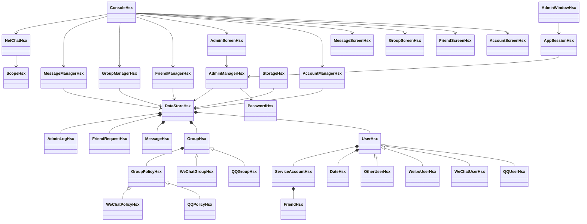

# 模拟即时通信系统设计说明

本系统将7种微X服务放在统一用户身份下，通过服务账号维护各自好友，通过群成员关联记录每个用户使用哪些服务入群。各业务模块共用一个数据仓库，界面只负责展示与输入，存档负责序列化和完整性校验。

## 课程要求对应

| 老师要求 | 新版实现与演示入口 |
|---|---|
| ID、昵称、出生时间、T龄、所在地、好友及群 | 账号与服务→我的资料；好友管理、我的群组 |
| 微博共享QQ号、微信独立号可绑定QQ、其它服务两种模式 | AccountManagerHsx的registerUser、open、bind |
| 好友添加、修改、删除、查询 | 好友管理；新增验证与双向关系 |
| 跨服务共同好友、推荐添加 | 好友管理→共同好友、跨服务推荐 |
| 初始化1001至1006等群号 | 默认演示群1001至1007；已迁移存档保留原群号 |
| 入群、退群、被移除、查询成员 | GroupManagerHsx与群组管理菜单 |
| QQ申请、管理员、讨论组；微信邀请与群主特权 | GroupPolicyHsx的两个派生策略 |
| 自选开通N项服务 | 账号与服务→服务管理，支持QQ、微信、微博及4项其它服务 |
| 一个服务登录，确认后联动其它服务 | 登录确认与统一用户会话；随后直接切换服务 |
| 动态改变群管理特色，成员数据保持完整 | 群管理→切换群模式，仅替换策略对象 |
| 数字菜单、允许返回 | 主菜单5类；子菜单0返回；表单/back取消 |
| 启动读文件、退出写文件与保存 | StorageHsx、业务修改自动保存、保存退出及EOF保存 |
| 抽象、封装、组合、继承、多态 | 用户类族、群类族、策略类族；数据私有，只读接口与业务入口 |
| 所有类独立文件、姓名缩写后缀 | 所有自定义类均有Hsx后缀，各自独立.h/.cpp |
| 必要注释与简单类图 | 关键校验、所有权、存档、TCP有注释；下方类图 |
| 选做QQ点对点TCP | WinSock长度帧、完整收发、接收线程、超时与资源释放 |

## 类关系

## 设计取舍

DataStoreHsx通过map和unique_ptr拥有用户、群、消息与申请。服务、好友、日期采用值对象；关系使用ID，避免昵称修改后数据不同步，也避免删除对象后的悬空指针。查找接口返回只读引用，写入仅由相应业务模块完成。

账号模块管理服务依赖和会话；好友模块管理申请、关系、分组与屏蔽；群模块管理权限和成员；消息模块管理发送、检索、回执、收藏和撤回。各模块不读取键盘或打印菜单。不同界面调用相同业务校验，避免每个菜单复制验证逻辑。

群原生类型决定对象类族，当前策略决定行为。切换只替换策略指针，成员、公告、申请、管理员配置和历史均保留。QQ群管理员在微信模式下暂停管理权限。讨论组与父群通过ID关联，成员必须通过同一服务属于父群。

退出父群、关闭服务和移除成员前先检查所有涉及的群，防止操作执行到一半才发现最后群主不能离开。群人数按用户数计算，服务关系单独存储。群主离开时优先转让给已配置的管理员，否则选择剩余成员；唯一群主不能直接离开。

消息中心统一处理私聊与群聊的可见性，非接收人、发送人或对应服务的群成员不能访问消息。查询不会自动生成回执，只有显示消息的界面才调用markRead。收藏和导出同样经过可见性校验；撤回清空正文和所有收藏。

存档加载在临时数据仓库完成解析与关系校验，失败时磁盘原文件和现有内存保持原样。保存完成全部写入后才替换主文件，并保留上一份数据。业务层标记dirty，统一界面在修改后保存；存档错误被明确显示。

本地私聊群聊使用模拟账号切换演示。桌面 TCP 页面已连接新增的独立多客户端中心服务器，使用远程账号认证、JSON 长度帧和 TLS，支持在线私聊及自动重连。数据库与离线消息尚未实现。命令行保留旧点对点演示，课程编号菜单仍由控制台入口提供。新架构、验证与 Linux 部署说明见「中心服务器与双端测试.md」。

Qt 前端由 `AppSessionHsx` 统一维护登录用户、当前服务、自动保存和界面刷新信号。`MainWindowHsx` 负责导航，七个页面分别调用已有业务接口。`FormDialogHsx` 与 `UiHsx` 复用表单和表格，避免每页重新编写输入和布局辅助代码。`NetworkPageHsx` 使用 Qt 异步套接字，收发时不会阻塞窗口。

桌面品牌为“听澜”。`AccountManagerHsx::findByNickname` 将唯一昵称解析为已有内部ID，注册自动分配ID，好友和群关系继续使用稳定的编号。普通桌面界面仅显示昵称，后台管理与登录记录保留ID；重复昵称在注册和改名时被拒绝，旧存档若存在重名则拒绝模糊登录。`LandscapeHsx` 直接绘制山水背景，`LoginMusicHsx` 通过 Qt Multimedia 播放打包的原创音乐与用户选择的本地歌曲，登录结束时停止播放。

所有新增自定义类也保留独立头文件、实现文件和 Hsx 后缀。业务层不依赖 Qt，因此原 Visual Studio 控制台工程不需要安装 Qt 就能构建。

系统管理员由独立凭据认证，普通用户或QQ群管理员身份不能授权系统管理操作。`AdminManagerHsx` 在每个管理入口校验会话，`AccountManagerHsx` 与 `DataStoreHsx::requireOnline` 校验登录限制。禁止登录、重置密码和强制登出会结束目标用户的模拟会话。`PasswordHsx` 使用 Windows CNG 生成随机盐并计算管理员密码摘要；`AdminLogHsx` 保存不含密码的操作记录。v4存档保存管理配置和最近2000条记录，兼容旧数据；登录身份在重启时清空。

## 答辩演示顺序

1. 运行演示，登录10001的QQ，确认联动，查看资料和群目录。
2. 查看QQ与微信共同好友，在微信中使用QQ好友推荐。
3. 切换10002的QQ，处理收到的微商好友申请，展示双向关系。
4. 进入1001群，切换QQ与微信策略，对比管理员权限与讨论组创建规则，查看成员保持完整。
5. 在消息中心连续发送、@成员、收藏、搜索、导出和撤回，切换接收账号检查回执。
6. 设定成员禁言，切换该成员验证发送被拒绝；解除后可重新发送。
7. 保存退出并重启，验证账号、关系和消息状态保留，登录状态不保留。
8. 创建两个远程账号并启动独立 im_server，启动两个桌面窗口连接服务器，以不同账号登录并展示中文双向 TCP 转发；断开服务器后展示自动重连。
9. 从登录页进入系统管理员后台，禁止10002登录，再用普通用户入口验证正确密码仍被拒绝；重新启用后重置密码，验证旧密码失效、新密码可登录，查看操作记录。

自动场景验证与真实菜单/TCP验证位于tests目录，结果记录于验证记录.md。
